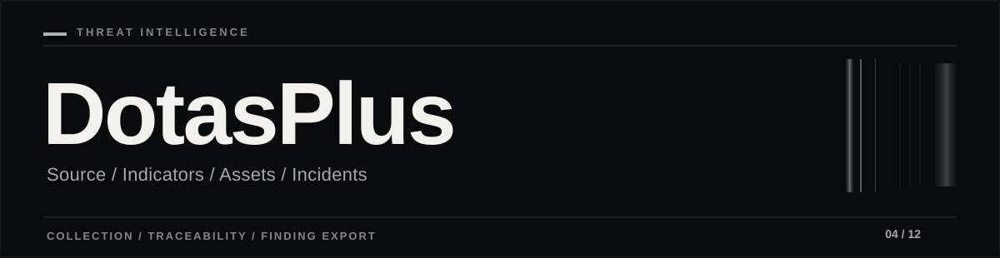
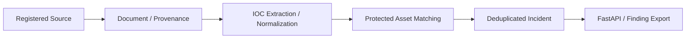

<picture>
  <source media="(max-width: 600px)" srcset="assets/portfolio-banner-mobile.svg">
  
</picture>

<a href="README.md">한국어</a> / <strong>English</strong>

# DotasPlus — Threat Intelligence Pipeline

**Python · IOC normalization · Asset matching · Incident tracking**  
**Documented development/test activity:** December 2025–September 2026

## Why build it?

Extracting an IOC is not enough: a useful security workflow must connect **a source document, an indicator, a protected asset and the resulting incident**. This prototype explores traceability rather than maximizing raw collection volume.

## Implemented workflow

1. **Acquire and normalize:** Parse a local source document and extract indicators
2. **Relate to assets:** Match indicators to registered protected assets and suppress duplicates
3. **Preserve evidence:** Record source context and output structured findings/incident references

**Evidence:** Nine local HTML/SQLite fixture tests passed. End-to-end live external collection and a full PostgreSQL/Redis/Celery deployment have not been verified.

[Earlier DOTAS work](https://github.com/rasasoe/DarkWeb_Alarm) · [Developer profile](https://github.com/rasasoe)

---

## Architecture

## Key components

- Source and protected-asset registration via FastAPI.
- Collected document preservation, extraction of IOC candidates, and normalization.
- Linking candidate indicators to registered assets and deduplicating incidents.
- Persistent ORM/API/task contracts and a common Finding v1.0 export.
- Optional notification integration, depending on configuration.
- Explicit scope boundaries; Tor routing is optional and requires an operator-configured SOCKS5h proxy.

## Evidence and limitations

- [PR #2](https://github.com/rasasoe/DotasPlus/pull/2/files): ORM/API/task contract alignment, persistence, duplicate handling and scope controls.
- **9 unit tests passed on September 16, 2026** using local HTML and SQLite fixtures for IOC parsing, asset matching, duplicate handling and collection boundaries.
- The recorded test run did **not** exercise a complete PostgreSQL / Redis / Celery Docker Compose stack or fetch external threat sites.
- An IOC match is **investigative context**, not proof of compromise or a measured detection rate.

## Project positioning

This is a **defensive CTI pipeline**, not an intrusion tool or a claim to have access to third-party private data. It complements [Python ASM](https://github.com/rasasoe/python-asm-framework) (external exposure) and [VSH](https://github.com/rasasoe/VSH) (application security).

## Run and configure

Please refer to the **[한국어 README](README.md)** for actual environment variables, API examples, scope allowlist configuration and tests. The project contains no credential bypass or data-exfiltration functionality.

---

*DotasPlus · Cyber Threat Intelligence / OSINT · Prototype*
