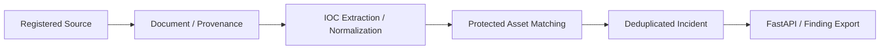

# DotasPlus — Cyber Threat Intelligence Pipeline

  
<a href="README.md">🇰🇷 한국어</a> · <strong>🇺🇸 English</strong>

  
   

---

> A prototype pipeline that connects the **source of a threat report → document → normalized IOC → protected asset → incident**.

## Architecture

## Key components

- Source and protected-asset registration via FastAPI.
- Collected document preservation, extraction of IOC candidates, and normalization.
- Linking candidate indicators to registered assets and deduplicating incidents.
- Persistent ORM/API/task contracts and a common Finding v1.0 export.
- Optional notification integration, depending on configuration.
- Explicit scope boundaries; Tor routing is optional and requires an operator-configured SOCKS5h proxy.

## Evidence and limitations

- [PR #2](https://github.com/rasasoe/DotasPlus/pull/2/files): ORM/API/task contract alignment, persistence, duplicate handling and scope controls.
- **9 unit tests passed on September 16, 2026** using local HTML and SQLite fixtures for IOC parsing, asset matching, duplicate handling and collection boundaries.
- The recorded test run did **not** exercise a complete PostgreSQL / Redis / Celery Docker Compose stack or fetch external threat sites.
- An IOC match is **investigative context**, not proof of compromise or a measured detection rate.

## Project positioning

This is a **defensive CTI pipeline**, not an intrusion tool or a claim to have access to third-party private data. It complements [Python ASM](https://github.com/rasasoe/python-asm-framework) (external exposure) and [VSH](https://github.com/rasasoe/VSH) (application security).

## Run and configure

Please refer to the **[한국어 README](README.md)** for actual environment variables, API examples, scope allowlist configuration and tests. The project contains no credential bypass or data-exfiltration functionality.

---

*DotasPlus · Cyber Threat Intelligence / OSINT · Prototype*
